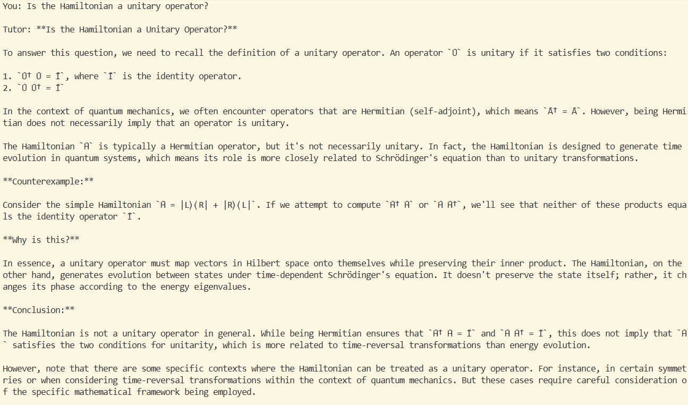
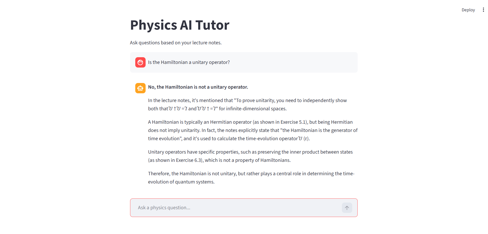
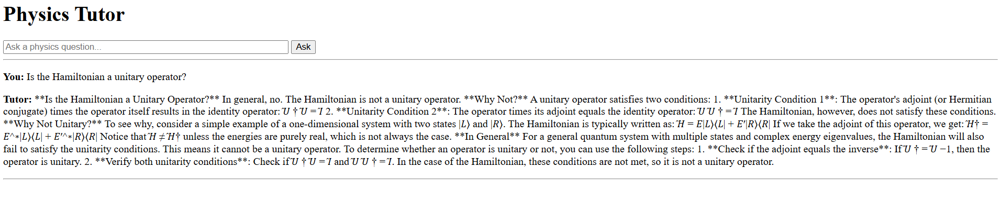

# University RAG Assistant

A Retrieval Augmented Generation (RAG) application that allows university students to ask questions about course-specific lecture notes using a local LLM and semantic search.

The project processes PDF lecture notes, stores them in a vector database, and retrieves relevant content to answer student questions accurately and efficiently.

## Retrieval Augmented Generation - RAG

Large Language Models (LLMs) often need relevant context provided from large databases or document collections. However, supplying an entire document collection or database for every user query is computationally expensive and often exceeds practical context limits.

Retrieval Augmented Generation (RAG) addresses this problem by first processing the source documents offline. Documents are loaded, split into smaller chunks, and converted into vector embeddings that capture the semantic meaning of the text. These embeddings are then stored in a vector database.

When a user asks a question, the question is embedded using the same embedding model and compared against the stored document embeddings. The most relevant chunks are retrieved and provided to the LLM as context. The LLM can then generate an answer using only the information most relevant to the user's query.

This approach significantly reduces the amount of text supplied to the model while improving the relevance and accuracy of responses. In this project, pdf documents are embedded using the `all-MiniLM-L6-v2` model, stored in a FAISS vector index, and supplied to a local Ollama-hosted LLM. 

## Features
- Local RAG pipeline using FAISS for vector storage
- Semantic search over lecture notes
- Local embeddings using `all-MiniLM-L6-v2`
- Local LLM inference using Ollama's `llama 3.1` model
- Command-line interface - (query.py)
- Streamlit web interface - (st_app.py)
- Flask web application prototype - (flask_app.py)
- Modular ingestion pipeline - (ingest.py)

## Motivations
Studying physics at Bristol, I used chatbots like ChatGPT and Claude by Anthropic as tools for revision. However, as course content speciallised more context was needed for accurate answers to be returned. RAG meant I could upload all of my lecture slides once for unlimited quick and accurate course-specific responses. 

## Pipeline

| Ingestion Pipeline | Query Pipeline |
|-------------------|----------------|
| PDF Lecture Notes | User Question |
| ↓ | ↓ |
| Document Loading | Embedding |
| ↓ | ↓ |
| Chunking | Similarity Search |
| ↓ | ↓ |
| Embeddings | Relevant Chunks |
| ↓ | ↓ |
| FAISS Index | Prompt + Context |
| | ↓ |
| | LLM Response |
## Project Structure

```
src/
├── load_pdf.py
├── chunking.py
├── embedding.py
├── vector_store.py
├── ingest.py
├── query.py
├── st_app.py
└── app.py

data/
└── lecture_notes.pdf

embeddings.index
chunks.pkl
```
## Design Choices

### FAISS
Chosen as a lightweight local vector database for fast semantic search and easy integration with Python.

### Ollama
Allows local LLM inference without external API costs or dependency on cloud providers.

### Streamlit
Used to rapidly prototype a user interface.

### Flask
Used to learn web application fundamentals and provide greater flexibility than Streamlit.

### React
Planned future frontend framework for a production-ready interface.

## Installation and Usage

### 1. Clone the repository:

```
git clone https://github.com/george-powell/university-RAG-assistant
cd university-RAG-assistant
```
### 2. Developer setup
create and activate a virtual environment:
```
python -m venv .venv
source .venv/bin/activate
```
### 3. Install dependencies
first install Ollama and pull the `llama3.1` model (or another desired model)
```
pip install -r requirements.txt
```
### 4. Build the vector database
processes PDF's, chunks them, then creates and stores vector embeddings in a FAISS Index.
```
python src/ingest.py
```
### 5. Run your chosen interface
You can interact with the LLM through 1 of the 3 interfaces
First run Ollama:

```
ollama serve
```
To run the command-line assistant:

```
python src/query.py
```

To run the Streamlit interface:

```
streamlit run src/st_app.py [ARGUMENTS]
```

To run the Flask interface:

```
python src/app.py
```

## Adaptations of the Interface
query.py:   
Command line chatbot
(useful POC while the backend was being developed)

st_app.py:  
Streamlit interface
(learned interactive UI + state)

flask_app.py:     
Flask web application
(learned web backend architecture and HTML code)

## Future Improvements
1. Improve flask UI
2. Persistent user accounts and chat history
3. React frontend
4. Past paper generation
5. Develop into a university-tutor SaaS

## Screenshots
I provided PDF documents from my provided university lecture notes, asking the content relevant question: "Is the Hamiltonian a unitary operator?"
### command-line Interface


### Streamlit Interface


### Flask Interface

